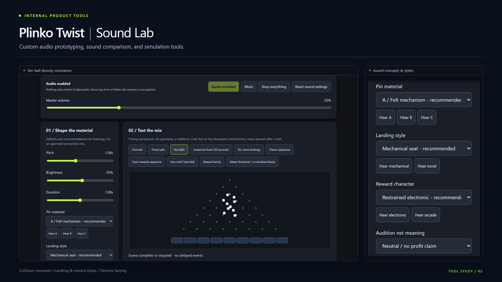
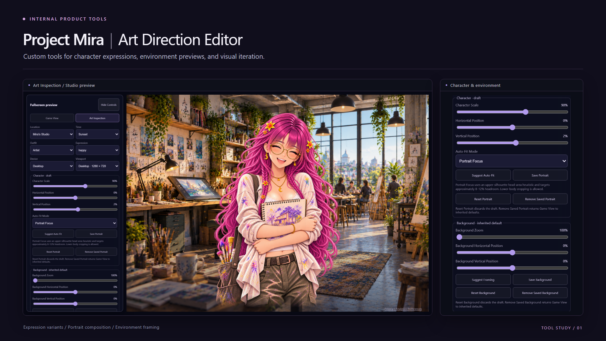

# Hi, I'm Dorin George Cristea 👋

**Lead Product Manager | Product Strategy | Systems Thinking | Growth & Monetization**

My career started in Game and Economy Design and evolved into Product Management and product leadership. Over more than a decade in F2P gaming and iGaming, I've worked on progression, retention, monetization, product strategy, platform integrations, and cross-functional delivery.

I tend to approach products as interconnected systems. A good feature matters, but so do the economics, technical capabilities, and team decisions that make it work in practice.

This profile showcases independent product work where I use AI-assisted development to take ideas beyond documents and into playable experiences and testable prototypes. I own the product direction, requirements, trade-offs, and validation; AI helps accelerate implementation, not replace product judgment.

## 🚀 Selected Product Work

### 🎯 Plinko Twist — Live Browser Game

**[Play Plinko Twist](https://plinko-twist.xtune0.workers.dev/)** · Live product · Private source repository

A browser game I took from concept to deployment, with **Classic and Twist modes**, **54 playable configurations**, original game mathematics, and **Provably Fair** outcome verification.

Twist adds interconnected mechanics such as upgradeable buckets, multiplier pins, Free Balls, and Twist Ball. The game runs on a Cloudflare-based backend with server-authoritative settlement, persistent sessions, and automated release validation. It uses **virtual credits only**.

**Focus:** Product ownership, economy and systems design, technical requirements, QA, and release delivery.

### 🛠️ Behind the Product: Sound Lab

I built an isolated Sound Lab to prototype and compare collision, landing, and reward sound concepts before integrating audio into the live game. It includes adjustable sound parameters, multi-ball density simulations, and automated checks so I can evaluate audio feedback without changing production gameplay.

### 💗 Project Mira — Interactive Narrative Game

**[Explore the playable demo](https://project-mira-demo.xtune0.chatgpt.site/)** · In development · Private source repository

A narrative-driven experience built around branching conversations, persistent memories, relationship progression, and interconnected gameplay systems. The design explores how player choices shape an evolving relationship and lead toward multiple possible endings.

**Focus:** Product vision, narrative and systems design, UX, conversation architecture, and iterative AI-assisted prototyping.

### 🛠️ Behind the Product: Art Direction Editor

I developed a custom Art Direction Editor to review character expression variants, adjust portrait scale and positioning, and refine environment framing in context. The tool supports faster visual iteration and more consistent presentation across the game's scenes.

### 📊 Monetization UX Experiment — Product Case Study

**[Explore the interactive prototype](https://fet-paywall-experiment.pages.dev/)** · Live prototype · Private source repository

A product analysis of subscription paywalls across web and Android journeys. I examined where users encounter restrictions, how subscription value is communicated, and how a more contextual paywall could improve decision-making.

I built a **current-versus-proposed interactive prototype** and validated its behavior with automated browser tests. This demonstrates a product hypothesis, not a claimed live conversion uplift.

**Focus:** Product discovery, UX analysis, monetization strategy, experimentation, and rapid prototyping.

## 🧩 How I Work

- **Product strategy and discovery:** finding the problem worth solving, defining scope, and making trade-offs explicit.
- **Product systems and monetization:** connecting user behavior, progression, retention, platform capabilities, and commercial outcomes.
- **Cross-functional delivery:** turning complex product decisions into requirements teams can build, test, and maintain.
- **AI-assisted prototyping:** using AI tools for implementation, then reviewing results through hands-on QA, automated testing, and iteration.

Most development repositories are private. The live demos and public case studies are here to show the products and the thinking behind them, rather than imply that this is a conventional software-engineering portfolio.

## 🔗 More About My Work

- **[LinkedIn](https://www.linkedin.com/in/dorin-george-cristea/)** — professional experience, product writing, and discussions.
- **[Portfolio & Articles](https://doringeorgecristea.blogspot.com/)** — product systems, game design, strategy, and monetization.

*Building products by understanding the systems behind them.*
